<p align="center">
  
</p>

# 💬 Awesome In-App & Direct Messaging 🚀

<p align="center">
  <a href="https://github.com/ishandutta2007/Awesome-Awesome-Awesome"></a><a href="https://discord.gg/jc4xtF58Ve"></a><a href="https://github.com/ishandutta2007/Awesome-In-App-Direct-Messaging/stargazers"></a><a href="https://github.com/ishandutta2007/Awesome-In-App-Direct-Messaging/network/members"></a><a href="LICENSE"></a><a href="https://github.com/ishandutta2007/Awesome-In-App-Direct-Messaging/pulls"></a><a href="https://github.com/ishandutta2007"></a>
</p>

---

### 🌟 A Curated Index of Real-Time Chat APIs, In-App Messaging SDKs & Open-Source Communication Infrastructure

Welcome to the definitive directory of **In-App Messaging** and **Direct Messaging (DM)** tools. Whether you are building 1:1 user direct messages, marketplace buyer-seller chat, multiplayer gaming channels, customer support inboxes, or privacy-hardened encrypted communications, this guide tracks industry-standard **cloud-hosted SaaS platforms** and **battle-tested open-source self-hosted solutions**.

> **SEO Keywords & Taxonomy**: In-App Messaging SDK, Chat API, Direct Messaging (DM), Real-Time WebSockets, iOS & Android Chat SDKs, React Native Chat UI Kit, Flutter Chat, Self-Hosted Chat Server, End-to-End Encryption (E2EE), Signal Protocol, CPaaS, Moderation, Live Chat Widget.

---

## 📑 Table of Contents
- [📊 Sector Overview & Market Dynamics](#-sector-overview--market-dynamics)
- [☁️ SaaS & Hosted Platforms](#️-saas--hosted-platforms)
- [🔓 Open-Source GitHub Projects](#-open-source-github-projects)
- [🧩 Key Architecture & Implementation Patterns](#-key-architecture--implementation-patterns)
- [📈 Star History](#-star-history)
- [💖 Support & Sponsoring](#-support--sponsoring)
- [🤝 How to Contribute](#-how-to-contribute)
- [⚖️ Disclaimer & Compliance](#️-disclaimer--compliance)

---

## 📊 Sector Overview & Market Dynamics

* **Market Size & Growth Runway**: The global in-app messaging and Communications Platform as a Service (CPaaS) market is valued at approximately **$4.2 Billion in 2024–2025** and is projected to surge past **$11.8 Billion by 2030**, recording a compound annual growth rate (**CAGR of ~18.5%**). Adoption is fueled by the ubiquity of real-time mobile commerce, telehealth consultations, gig-economy coordination, and collaborative workplace workflows.
* **Fragmentation vs. Concentration Dynamics**: The sector exhibits **moderate fragmentation** rather than a winner-take-all monopoly:
  * **Enterprise CRM & Omnichannel Titans** (*Salesforce, Twilio, Intercom*) dominate large enterprises requiring tight coupling between conversations, ticketing, customer 360 profiles, and marketing automation.
  * **Specialized Developer-First Chat API Providers** (*Sendbird, Stream, CometChat, TalkJS, PubNub*) hold deep moats around pre-packaged client UI kits (React, iOS, Android, Flutter), low-latency WebSocket global meshes, and turnkey moderation.
  * **Self-Hosted & Open-Source Solutions** (*Rocket.Chat, Mattermost, Chatwoot, SimpleX, Tinode*) capture surging demand from privacy-conscious enterprises, healthcare providers, and European organizations adhering to GDPR, HIPAA, and data sovereignty mandates.

---

## ☁️ SaaS & Hosted Platforms

The table below catalogs leading commercial in-app chat APIs and hosted messaging platforms, **sorted in descending order by company scale (revenue / market valuation)**.

| 🏢 Platform | 📈 Company Scale (Valuation / Revenue) | 💳 Starting Tier Pricing | 🎁 Free Tier / Trial Limit | 🛠️ Core Capabilities & SDKs |
| :--- | :--- | :--- | :--- | :--- |
| **[Salesforce Direct Messaging](https://www.salesforce.com/)** | **~$34.8B+ Rev** / **$280B+ Market Cap** *(NYSE: CRM)* | **$25/user/month** *(Starter Suite)* or **$100/user/mo** *(Service Cloud Digital Engagement)* | **30-day free trial** with full Service Cloud access, pre-configured in-app messaging, no credit card required | Embedded web & in-app chat, CRM workflow automation, omnichannel routing, Einstein AI bots, SOC2/HIPAA compliance. |
| **[Twilio Conversations](https://www.twilio.com/en-us/messaging/conversations)** | **~$4.15B Rev** / **~$11B Market Cap** *(NYSE: TWLO)* | **$0.05 per active user/month** *(or $0.005/message)* | **$15.50 free trial credits** upon sign-up *(unlimited sandbox testing period, full API access)* | Cross-channel conversation state engine bridging In-App chat, SMS, WhatsApp, and MMS into unified participant threads. |
| **[Pusher Channels](https://pusher.com/)** *(by Bird)* | **~$600M+ ARR** *(Parent Bird)* / **$3.8B Peak Valuation** | **$49/month** *(up to 500 concurrent connections, 1M messages/day)* | **Free forever plan** up to **200,000 messages/day** and **100 concurrent connections** | Hosted real-time WebSocket pub/sub API, client presence tracking, client events, webhooks, end-to-end encryption support. |
| **[Intercom Messenger](https://www.intercom.com/)** | **~$300M+ ARR** / **$1.275B+ Valuation** *(Unicorn)* | **$39/seat/month** *(Essential plan)* | **14-day free trial** with unlimited seats, includes Fin AI Agent, Copilot, Help Center, cardless signup | Customizable in-app messenger widget, proactive outbound messages, automated bot workflows, live support ticketing. |
| **[Agora Chat](https://www.agora.io/en/products/chat/)** | **~$130M Rev** / **~$350M Market Cap** *(NASDAQ: API)* | **$349/month** *(Standard plan with up to 5,000 MAUs)* | **Free forever plan** up to **25 MAUs**; includes 10,000 free minutes/month for audio/video RTC | Global Software Defined Real-time Network (SD-RTN), group chat, presence, rich multimedia messaging, voice/video tie-in. |
| **[Sendbird](https://sendbird.com/)** | **$1.05B Valuation** *(Unicorn)* / **~$50M ARR** | **$399/month** *(Starter plan with up to 5,000 MAUs; $0.08/MAU overage)* | **Free forever Developer plan** up to **100 MAUs** & 10 peak connections; **30-day Pro trial** *(up to 1,000 MAUs)* | Turnkey UIKits for iOS, Android, React, React Native, Flutter; AI SmartAssistant, moderation engine, 5M user channels. |
| **[PubNub](https://www.pubnub.com/)** | **$130M+ Total Funding** / **~$40M ARR** | **$49/month** *(Starter plan up to 1,500 MAUs or 1M transactions)* | **Free forever plan** up to **200 MAUs**, **1,000,000 transactions/month**, and 1 GB data persistence | Global edge network, pub/sub messaging, user presence detection, App Context state sync, mobile push notification gateway. |
| **[Ably Chat](https://ably.com/chat)** | **$110M+ Total Funding** *(Series B)* / **~$25M ARR** | **$29/month** *(Pay-as-you-go; $0.0025 per 1,000 messages)* | **Free forever plan** up to **6,000,000 messages/month** and **200 peak concurrent connections** | 99.999% SLA serverless realtime fabric, room reactions, chat presence, typing indicators, guaranteed ordering. |
| **[Stream Chat (GetStream)](https://getstream.io/chat/)** | **$58M+ Total Funding** *(Series B)* / **~$30M ARR** | **$499/month** *(Standard plan with 10,000 MAUs; $0.09/MAU overage)* | **Free forever Maker/Build plan** up to **1,000 MAUs**, 100 concurrent connections, 5M stored messages | Sub-10ms global latency, 5M+ concurrent users per channel, SDKs for React, Flutter, SwiftUI, Jetpack Compose, AI Assistants. |
| **[MirrorFly](https://www.mirrorfly.com/)** | **~$50M+ Enterprise Rev** *(Parent CONTUS)* | **$399/month** *(Cloud SaaS 5,000 MAUs)* or **$2,999** one-time lifetime license | **21-day free trial** with developer sandbox access, SDK downloads, and interactive technical demo | 100% customizable white-label chat SDK, self-hosted on-premise deployment option with complete source code ownership. |
| **[CometChat](https://www.cometchat.com/)** | **$13M+ Total Funding** *(Series A)* / **~$5M ARR** | **$109/month** *(Launch plan with 1,000 MAUs; $0.15/MAU overage)* | **Free forever Build plan** up to **100 MAUs**, core UI kits, and 10,000 voice/video calling minutes | Drop-in chat UI widgets, role-based channel permissions, automated bot moderation, voice/video calls, extensions marketplace. |
| **[TalkJS](https://talkjs.com/)** | **~$5M ARR** *(Bootstrapped & profitable)* | **$279/month** *(Basic plan with up to 10,000 MAUs; $0.04/MAU overage)* | **Free forever development sandbox** *(unlimited dev/test with watermarks)*; **14-day production trial** | Pre-built drop-in chat UI widget, notification fallbacks (email/SMS), marketplace buyer-seller chat, multi-language support. |
| **[Applozic](https://www.applozic.com/)** | **~$1M Seed Funding** *(Acquired)* | **$199/month** *(Starter tier up to 2,000 MAUs)* | **30-day free trial** with full SDK access and up to 1,000 test MAUs | Mobile & web in-app chat SDK, push notifications, contextual customer support chat, group channels, custom webhooks. |

---

## 🔓 Open-Source GitHub Projects

Explore the leading self-hosted messaging engines, decentralized chat protocols, and developer libraries, **sorted in descending order by GitHub Stars_Count**.

* **[Rocket.Chat](https://github.com/RocketChat/Rocket.Chat)** [](https://github.com/RocketChat/Rocket.Chat/stargazers)  
  *The ultimate open-source communication platform & Hub.* Full-featured Slack/Teams alternative with omnichannel customer support live chat, team direct messaging, voice/video conferencing, and an extensive marketplace of integrations. Deployable via Docker, Kubernetes, or source.

* **[Novu](https://github.com/novuhq/novu)** [](https://github.com/novuhq/novu/stargazers)  
  *Open-source notification & in-app inbox infrastructure.* Provides drop-in React, Vue, Angular, and web components for user-facing in-app message feeds, bell notifications, user notification preferences, and multi-channel delivery workflows (Push, Email, SMS, Chat).

* **[Mattermost](https://github.com/mattermost/mattermost)** [](https://github.com/mattermost/mattermost/stargazers)  
  *Secure, self-hosted collaboration platform for technical and operational teams.* Written in Go and React, featuring 1:1 direct messages, role-based channels, integrated playbooks, board task management, and deep developer tooling integrations.

* **[Chatwoot](https://github.com/chatwoot/chatwoot)** [](https://github.com/chatwoot/chatwoot/stargazers)  
  *Open-source customer engagement & live chat platform.* Intercom/Zendesk alternative featuring an embeddable in-app live chat widget for mobile and web apps, unified inbox, multi-agent collaboration, canned responses, and custom webhooks.

* **[Zulip](https://github.com/zulip/zulip)** [](https://github.com/zulip/zulip/stargazers)  
  *Organized team chat combining real-time messaging with email-style threading.* Allows teams to easily follow asynchronous topic threads while maintaining real-time conversation flows. Features enterprise LDAP/SAML, markdown, and full REST APIs.

* **[SimpleX Chat](https://github.com/simplex-chat/simplex-chat)** [](https://github.com/simplex-chat/simplex-chat/stargazers)  
  *Privacy-first decentralized messaging protocol with zero user IDs.* Eliminates phone numbers, usernames, and permanent network identifiers. Delivers end-to-end encrypted direct messaging, encrypted group chats, and self-hosted relay queues.

* **[Element Web](https://github.com/element-hq/element-web)** [](https://github.com/element-hq/element-web/stargazers)  
  *Flagship web client for the decentralized Matrix communication protocol.* End-to-end encrypted messaging, decentralized room federation, voice/video calls via WebRTC, and bridges to Slack, Discord, and Telegram.

* **[Tinode](https://github.com/tinode/chat)** [](https://github.com/tinode/chat/stargazers)  
  *Pure Go instant messaging server and client SDKs.* Highly performant, database-agnostic (MySQL, PostgreSQL, MongoDB, RethinkDB) IM server with gRPC and WebSocket APIs. Provides native SDKs for Android (Java/Kotlin), iOS (Swift), and Web (JavaScript).

* **[Matrix Synapse](https://github.com/matrix-org/synapse)** [](https://github.com/matrix-org/synapse/stargazers)  
  *Reference homeserver for the Matrix open communication standard.* Powers decentralized real-time messaging, cryptographic identity signing, room state synchronization, and federation across independent servers.

* **[Centrifugo](https://github.com/centrifugal/centrifugo)** [](https://github.com/centrifugal/centrifugo/stargazers)  
  *Scalable real-time messaging server in Go.* Connects to existing application backends over WebSocket, HTTP-streaming, or SSE to power live chat rooms, user presence detection, message histories, and channel broadcast distribution.

* **[Matterbridge](https://github.com/42wim/matterbridge)** [](https://github.com/42wim/matterbridge/stargazers)  
  *Universal chat bridge daemon.* Interconnects conversations across Mattermost, Slack, Discord, Matrix, Telegram, IRC, XMPP, Zulip, and Rocket.Chat with bi-directional message routing.

* **[Stoat (formerly Revolt Backend)](https://github.com/stoatchat/stoatchat)** [](https://github.com/stoatchat/stoatchat/stargazers)  
  *Open-source community chat platform written in Rust.* Privacy-respecting Discord alternative offering customizable servers, channels, direct messages, role permissions, and WebSocket event feeds.

* **[Converse.js](https://github.com/conversejs/converse.js)** [](https://github.com/conversejs/converse.js/stargazers)  
  *Embeddable web chat client for XMPP.* Can be integrated into existing web apps as an overlay floating chat dock or full-page messaging app. Supports OMEMO end-to-end encryption, multi-user chat (MUC), and vCards.

* **[Wire Server](https://github.com/wireapp/wire-server)** [](https://github.com/wireapp/wire-server/stargazers)  
  *Enterprise-grade secure collaboration backend.* Written in Haskell and deployed with Kubernetes/Cassandra, delivering end-to-end encrypted messaging, voice/video conferencing, and strict European data privacy compliance.

* **[c-toxcore](https://github.com/TokTok/c-toxcore)** [](https://github.com/TokTok/c-toxcore/stargazers)  
  *Peer-to-peer (P2P) decentralized messaging core library.* Zero servers, zero metadata tracking. Connects users over DHT with NaCl (Curve25519) encryption for text, audio, and file transfers.

* **[Turms](https://github.com/turms-im/turms)** [](https://github.com/turms-im/turms/stargazers)  
  *Extreme-scale distributed instant messaging engine.* Built on Java and Spring WebFlux, engineered to handle 100K to 10M+ concurrent online users with sub-millisecond latencies and pluggable business logic.

* **[Mqvi](https://github.com/akinalpfdn/Mqvi)** [](https://github.com/akinalpfdn/Mqvi/stargazers)  
  *No-ID communication platform with voice, video, and text.* Features Signal-protocol end-to-end encrypted direct messaging (X3DH + Double Ratchet), LiveKit audio/video, and zero user data retention.

* **[PlugChat](https://github.com/cLLeB/plugchat)** [](https://github.com/cLLeB/plugchat/stargazers)  
  *Zero-database-sync self-hosted chat process.* Trusts JWTs signed by your backend, eliminating user table synchronization. Supports 1:1 direct conversations, group channels, disappearing messages, and built-in WebRTC calls.

* **[Poolse JS SDK](https://github.com/poolse-hq/js-sdk)** [](https://github.com/poolse-hq/js-sdk/stargazers)  
  *Real-time TypeScript chat SDK with React and React Native components.* Turnkey drop-in UI kit supporting messages, presence, typing indicators, reactions, threads, and offline queues.

---

## 🧩 Key Architecture & Implementation Patterns

```
      +--------------------------------------------------------+
      |                 Client Applications                    |
      |   [React / Web]    [iOS / Swift]    [Android / Kotlin] |
      +--------------------------------------------------------+
                                  |
                                  v
       +-------------------------------------------------------+
       |             Transport & Protocol Layer                |
       |  • WebSockets (RFC 6455)  • WebRTC Data Channels      |
       |  • SSE (Server-Sent)      • gRPC / HTTP/2 Streaming   |
       +-------------------------------------------------------+
                                  |
            +---------------------+---------------------+
            |                                           |
            v                                           v
+-----------------------+                   +-----------------------+
|  Cloud-Hosted SaaS    |                   |   Self-Hosted OSS     |
| • Sendbird / Stream   |                   | • Rocket.Chat / Zulip |
| • PubNub / Ably       |                   | • Matrix / Tinode     |
| • Twilio / Salesforce |                   | • Centrifugo / SimpleX|
+-----------------------+                   +-----------------------+
            |                                           |
            +---------------------+---------------------+
                                  |
                                  v
      +--------------------------------------------------------+
      |              Persistence & Message Delivery            |
      |  • Ephemeral Presence (Redis Pub/Sub)                  |
      |  • Message Archives (PostgreSQL / Cassandra / Scylla)  |
      |  • Push Notification Gateway (APNs / FCM)              |
      +--------------------------------------------------------+
```

---

## 📈 Star History

[](https://star-history.dera.page/#ishandutta2007/Awesome-In-App-Direct-Messaging&type=date&legend=top-left)

---

## 💖 Support & Sponsoring

If you found this curated ecosystem useful for your project, product architecture, or engineering team:
* ⭐ **Star this repository** to show your appreciation and help more developers discover it!
* 🍴 **Fork the repo** to contribute new chat SDKs, benchmarks, or updates.
* 📢 **Share with colleagues** across engineering channels, Discord, Twitter/X, and LinkedIn.
* ☕ **Support the maintainer**: Buy a coffee or sponsor ongoing maintenance directly via the [GitHub Sponsor Dashboard](https://github.com/sponsors/ishandutta2007). Every bit of support is deeply appreciated!

---

## 🤝 How to Contribute

We welcome community contributions! To add a new platform, SDK, or open-source repository:
1. **Fork the repository** to your GitHub account.
2. Ensure the project is active, well-documented, and relevant to in-app or direct messaging.
3. Add the entry to either the SaaS table or the Open-Source list (maintaining sorting rules).
4. For SaaS tools: include starting tier pricing, free limits, and company scale.
5. For Open-Source tools: include a social-style white Stars_Badge linking to its `/stargazers` page.
6. Open a clear Pull Request detailing your changes.

---

## ⚖️ Disclaimer & Compliance

* **Independent Resource**: This repository is a community-curated directory. Listed trademarks, logos, and product names belong to their respective owners.
* **Compliance Notice**: In-app messaging implementations handling sensitive communication must adhere to applicable regulatory frameworks, including **GDPR**, **CCPA**, **HIPAA**, and **SOC 2 Type II**.
* **Self-Hosting Security**: When deploying self-hosted open-source software, ensure proper TLS/SSL termination, database encryption-at-rest, periodic dependency auditing, and strict key management.

---

<p align="center">
  <b>Built with ❤️ for Mobile Developers, Product Engineers &amp; Real-Time Systems Architects</b>
</p>
